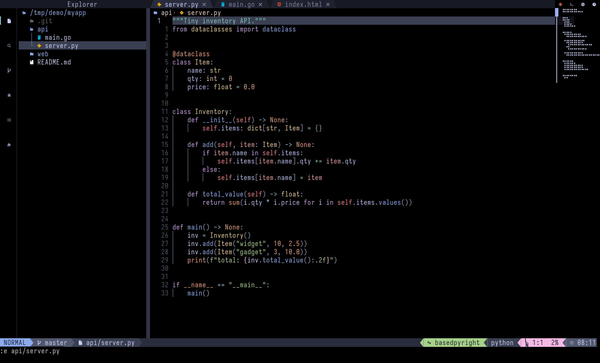
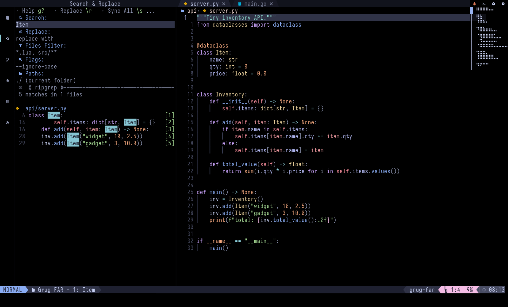
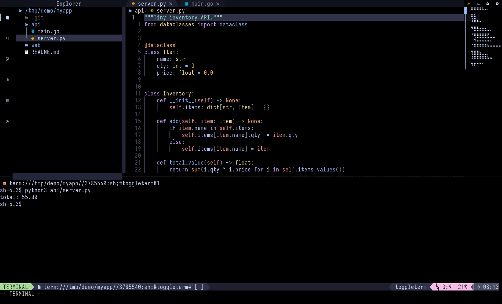
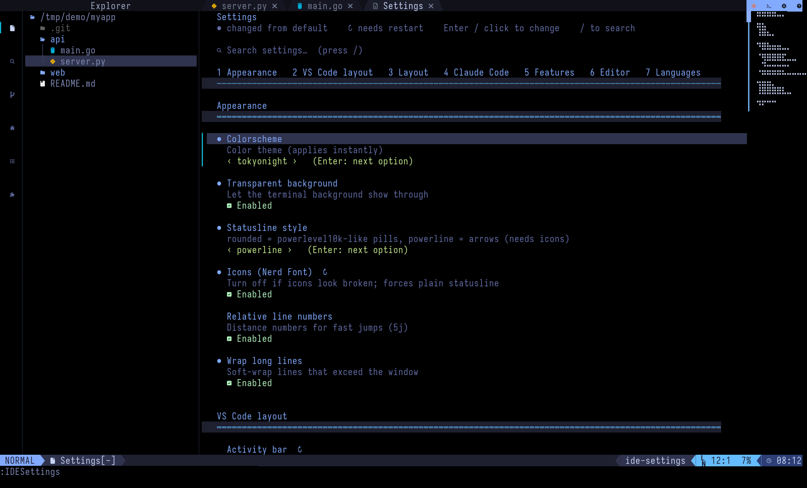
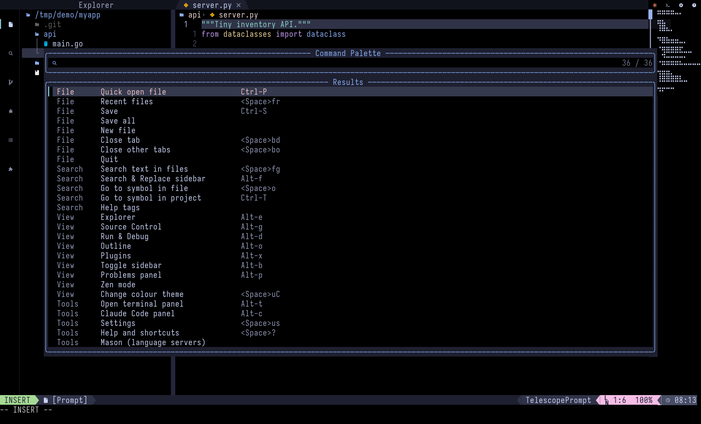

# nvim-ide

A VS Code-style IDE built on Neovim (0.11+), configured entirely in Lua. It is mouse-friendly,
works inside tmux, and every screen shares one design system.

- **Layout:** activity bar (Explorer, Search & Replace, Source Control, Run & Debug, Outline, Plugins), file tabs, breadcrumbs, statusline in a Powerlevel10k style, optional minimap.
- **Search & Replace:** project-wide, in a sidebar (grug-far). Results open in the editor area.
- **Claude Code:** embedded side panel (`coder/claudecode.nvim`; needs the `claude` CLI).
- **Terminal:** bottom panel (Alt-t), or the button at the top right.
- **Languages:** Python, Go, HTML/CSS, JavaScript, Terraform, Bash, Markdown, JSON, YAML, Lua. Each has an LSP, tree-sitter, a formatter and a linter (installed through Mason).
- **In-editor Settings and Help pages:** 29 colour themes, transparent mode, statusline style and feature toggles. They are saved outside the config, so updates don't overwrite them.
- **Command palette:** F1 or `<Space>P`.
- **Launcher:** `ide`, `ide claude`, `ide settings`, `ide help`.
- **Debugger option:** Settings > Features > Debugger switches Run & Debug on or off: the activity-bar icon, F5/F9/F10/F11, the palette entries and the debug plugins all follow it.
- **Source Control sidebar:** A real Git panel: branch, commit box, staged / changed / untracked files, click for the diff, + - x to stage, unstage or discard, buttons for commit, pull and push, branch switching.
- **First-run welcome and doctor:** A welcome page on the first start (icon check, tool check, first keys) and `:IDEDoctor`, which lists missing tools with the exact install command for your system.
- **Session restore and recent projects:** Quitting saves the open files per folder and `ide` reopens them. Palette > Recent projects (and the dashboard `o` key) switches folders.
- **Tab features:** Right-click a tab for pin, move, close others / to the right, copy path and reveal in Explorer. Alt-< / Alt-> move a tab; Shift-h / Shift-l follow the tab order.
- **Splits and layouts:** Split right / below, close, maximize and equalize editor windows; save and load named layouts.
- **Task runner:** Finds Makefile targets, npm scripts, go, pytest, cargo, terraform, justfile and .vscode tasks and runs them in the terminal panel (`<Space>rt`, `<Space>rr`).
- **Test runner:** Run all / last / stop keys and palette entries for neotest, with pass and fail marks in the gutter.
- **Explorer actions:** Terminal in the folder, copy path, open in the system file manager and search inside a folder from the Explorer.
- **Problems panel:** The Problems panel groups diagnostics by file with counts and takes focus when opened.
- **Snippets and Claude on a selection:** Snippet browser for the current file type and an action that sends the selection or file to Claude.
- **Remote and containers:** SSH shell, edit a remote file over scp, shell in a running container or the folder's dev container.

## Screenshots



| Search & Replace | Terminal panel |
|---|---|
|  |  |
| **Settings page** | **Command palette (F1)** |
|  |  |

## Requirements

- Neovim **0.11 or newer** (tested on 0.12)
- `git`, `make`, a C compiler (`gcc`), `ripgrep`, `node`, `tree-sitter` CLI
- A terminal using a [Nerd Font](https://www.nerdfonts.com/) (icons, tab and statusline shapes) and true colour. Optional: `tmux`, the `claude` CLI, `lazygit`.

```sh
# Fedora
sudo dnf install -y neovim git make gcc ripgrep nodejs tree-sitter-cli
# Debian / Ubuntu
sudo apt install -y neovim git make gcc ripgrep nodejs && npm i -g tree-sitter-cli
# macOS
brew install neovim git ripgrep node tree-sitter
```

Check what is missing at any time with `nvim-ide/scripts/doctor.sh`.

## Install

```sh
git clone https://github.com/a-goodarzi/vim-ide.git
cd vim-ide/nvim-ide
bash scripts/dev.sh --skip-tmux          # or without flags to also run the tmux render check
```

`dev.sh` does the following. It never uses `sudo`:
1. Checks dependencies and prints the install command for anything missing.
2. Links `~/.config/nvim-ide` to `assets/template` (use `--copy` for a copy instead).
3. Links the `ide` launcher to `~/.local/bin/ide` (add that folder to your `PATH`).
4. Installs plugins and Mason tools (`--skip-mason` to skip them).
5. Runs the smoke tests.

It uses `NVIM_APPNAME=nvim-ide`, so **your existing `~/.config/nvim` is not touched**. Start with `ide`.

To use it as your main Neovim config instead:
```sh
bash nvim-ide/scripts/install.sh            # backs up an existing ~/.config/nvim to nvim.bak-<timestamp>
bash nvim-ide/scripts/install.sh --langs python,go --link-bin
```

Update with `ide update` (plugins and tools) or `bash scripts/dev.sh --update`.

## macOS notes

The scripts avoid GNU-only tools, but I developed and tested this on Linux (Fedora) only, so treat macOS as untested.
- Alt shortcuts (Alt-t, Alt-c, Alt-e ...) need the Option key to act as Meta: Terminal.app > Settings > Profiles > Keyboard > "Use Option as Meta key"; iTerm2 > Profiles > Keys > Left Option key = Esc+; kitty: `macos_option_as_alt yes`; WezTerm: `send_composed_key_when_left_alt_is_pressed = false`.
- The launcher uses `readlink -f`, which needs macOS 12.3 or newer.
- macOS ships bash 3.2; if a script fails, install a newer one with `brew install bash`.

## First steps

| Action | Key |
|---|---|
| Help and every shortcut | `<Space>?` (leader is Space; pause after it for a menu) |
| Settings (themes, features) | `<Space>us` or the gear button |
| Command palette | `F1` |
| Quick open file | `Ctrl-P` |
| Search in files | `Alt-f` |
| Terminal / Claude panel | `Alt-t` / `Alt-c` |

For tmux, add `nvim-ide/assets/template/extras/tmux.conf` to your tmux config (true colour, clipboard, escape time).

## Repository layout

| Path | Contents |
|---|---|
| `nvim-ide/assets/template/` | The Neovim config (`init.lua`, `lua/config`, `lua/plugins`, `extras/`) |
| `nvim-ide/scripts/` | `dev.sh`, `install.sh`, `doctor.sh`, `smoke.lua` (regression tests) |
| `nvim-ide/SKILL.md`, `references/` | A Claude skill for building and maintaining this IDE |
| `nvim-tui-ux/` | A Claude skill with the UI/UX rules and lessons learned, a UI lint (`scripts/ui_lint.py`) and the shared UI kit |

The two skills are also provided as `nvim-ide.skill` and `nvim-tui-ux.skill`, which can be installed in Claude.

## Development

```sh
bash nvim-ide/scripts/dev.sh --skip-mason --no-run                # install, 98 smoke tests, tmux render check
python3 nvim-tui-ux/scripts/ui_lint.py --strict nvim-ide/assets/template/lua
```

## Troubleshooting

- **Icons show as boxes:** set a Nerd Font in your terminal, or turn Icons off in Settings.
- **Colours look wrong in tmux:** use `extras/tmux.conf`.
- **A language server is missing:** run `:Mason`.
- **Debugger does nothing:** `:MasonInstall debugpy` (Python) or the matching adapter.
- **Claude button does nothing:** install the `claude` CLI, or set `claude.terminal_cmd` in Settings.

## License

Copyright (C) 2026 Amirhossein Goodarzi

Released under the **GNU General Public License v3.0 or later** (GPL-3.0-or-later); see [LICENSE](LICENSE).
You may use, modify and redistribute it, but derived versions must be released under the same license with source.
Plugins that the config downloads keep their own licenses.
